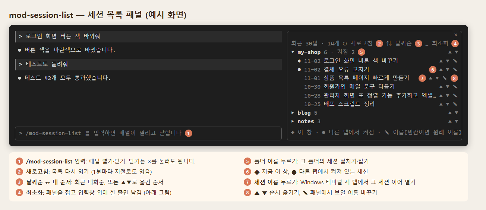
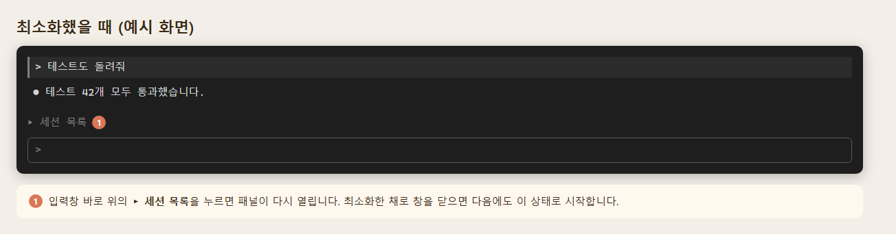
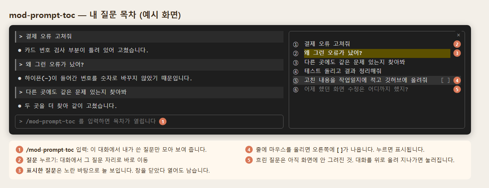

# Claude-Mod

Claude Code 터미널에 붙여 쓰는 모드 2개입니다.

윈도우는 TMUX 같은거 잘 되는 것도 없고 에러도 많고, ORCA는 raidrive연결이 안되고..... 클로드코드앱은 클로드코드랑 연동도 잘 안되고. 
클로드코드 쓰면서 제가 불편했던 것 중 두 가지만 만들어봤습니다. 이것만 돼도 너무 편하고 살거 같네요.  

1. 내가 만들고 있는 여러가지 프로젝트들 목록 일목요연하게 보기
2. 현재 대화창에서 내가 했던 질문 빨리 찾아가기. 중요 대화 표시해두기.
   

| 모드 | 하는 일 | 여는 명령 |
|---|---|---|
| `mod-session-list` | 최근 30일 세션을 프로젝트별로 보여 주는 패널. 누르면 새 탭에서 그 세션을 엽니다. | `/mod-session-list` |
| `mod-prompt-toc` | 이 대화에서 내가 적은 질문(프롬프트)만 모아 목차로 보여 줍니다. 누르면 그 질문으로 이동합니다. | `/mod-prompt-toc` |
| `mod-memo` | 오른쪽 패널의 메모 탭에서 Dynalist처럼 불렛으로 적습니다(Enter 다음 줄, Tab 하위, Shift+Tab 상위, 완료·접기·되돌리기). 마크다운 파일로 저장되고 모든 창이 같은 메모를 봅니다. | `/mod-memo` |

## 어떻게 쓰나요

아래 그림은 사용법을 보여 주는 예시 화면입니다. 내용은 지어낸 것입니다.

### 세션목록 (`mod-session-list`)





### 대화내역 (`mod-prompt-toc`)



### 메모 (`mod-memo`)

메모 칸을 한 번 누르고 바로 칩니다. `Esc`를 누르면 입력창으로 돌아갑니다.

| 키 | 동작 |
|---|---|
| `Enter` | 다음 불렛 (줄 가운데서 치면 줄이 나뉨) |
| `Tab` | 하위 불렛으로 |
| `Shift+Tab` | 상위 불렛으로 |
| `Backspace` | 글자 지우기. 빈 줄이면 바로 삭제, 줄 맨 앞이면 앞 줄에 붙임 |
| `↑` `↓` `←` `→` | 커서 이동 |
| `Ctrl+↑` `Ctrl+↓` 또는 `▲` `▼` | 줄 이동 (상위는 하위와 함께) |
| `×` | 줄 삭제 |
| `Ctrl+Z` 또는 `↶ 되돌리기` | 되돌리기 |
| `Ctrl+K` 또는 불렛 클릭 | 완료 표시(☑) |
| `▾` 클릭 | 상위 메모 접기·펴기 |
| 끌기 또는 `Shift+←` `Shift+→` | 글 선택. 고르면 바로 복사됨 |
| 오른쪽 클릭 또는 `붙여넣기` 단추 | 붙여넣기. 여러 줄이면 줄마다 불렛이 됨 |

메모는 `~/.claude/plugins/mod-memo.md`에 마크다운 목록으로 저장됩니다. 패널에서는 서식을 그리지 않고 글자 그대로 보여 줍니다. `Ctrl+V`는 메모 칸까지 오지 않아 위 방법으로 붙여넣습니다.

알아 둘 점:

- 고른 글은 바로 복사됩니다. `Ctrl+C`는 Claude Code가 먼저 가져가 메모 칸에서 빠져나옵니다.
- 고른 채로 `Backspace`를 누르면 지워지고, 글자를 치면 그 글로 바뀝니다.
- 여러 줄은 끌어서 고릅니다.
- `Ctrl+D`는 Claude Code 종료 키라서 완료 표시는 `Ctrl+K`를 씁니다.
- 음성 입력이 켜져 있으면 기본 키 `Space`를 음성 입력이 먼저 가져가 메모에서 띄어쓰기가 되지 않습니다. `keybindings.json`에서 음성 키를 다른 키로 옮기거나 `/voice`로 끄세요.

## 설치

Claude Code 입력창에서:

```
/plugin install mod-session-list --marketplace archep29/Claude-Mod
/plugin install mod-prompt-toc --marketplace archep29/Claude-Mod
/plugin install mod-memo --marketplace archep29/Claude-Mod
```

`Add marketplace?`가 나오면 `y`, 범위는 Enter로 고릅니다.

명령창(셸)에서:

```
claude plugin install mod-session-list --marketplace archep29/Claude-Mod
claude plugin install mod-prompt-toc --marketplace archep29/Claude-Mod
claude plugin install mod-memo --marketplace archep29/Claude-Mod
```

데스크톱 앱에서는 입력창 옆 + → Plugins → Add marketplace에 `archep29/Claude-Mod`를 넣고 Add plugin을 누릅니다.

## 설치 후 켜고 끄기

설치하면 Claude Code를 새로 켤 때 패널이 저절로 열립니다(터미널 창이 넓을 때). 입력창에 `/` 명령을 쳐서 켜고 끕니다.

| 모드 | 켜기 | 끄기 |
|---|---|---|
| 세션목록 | `/mod-session-list` | `/mod-session-list` 한 번 더, 또는 「_ 최소화」 |
| 대화내역 | `/mod-prompt-toc` | `/mod-prompt-toc` 한 번 더, 또는 패널 오른쪽 위 `×` |
| 메모 | `/mod-memo` | `/mod-memo` 한 번 더, 또는 패널 오른쪽 위 `×` |

- 세션목록 맨 윗줄의 「▸ 다 닫기」를 누르면 펼친 폴더가 한 번에 모두 접힙니다(펼친 폴더가 있을 때만 보임).
- 세션목록을 「_ 최소화」로 접으면 입력창 위 「▸ 세션목록」 한 줄만 남고, 그 줄을 누르면 다시 열립니다.
- 모드 자체를 아예 쓰지 않으려면 `/plugin`에서 끄거나 지웁니다.

## mod-session-list 필요 조건

- Windows, Windows 터미널(`wt`)
- Python(`py` 명령)
- 세션을 누르면 새 탭에서 `claude --resume <세션 id>`로 엽니다.
